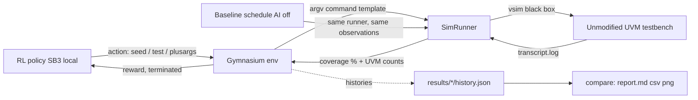

# AId-VO Architecture

## 1. Purpose and design principles

AId-VO (AI-Driven Verification Optimization) accelerates functional coverage
closure for **any** third-party testbench written in HDL/HVL/HLS languages and
verification methodologies (UVM, etc.) **without modifying the testbench or
touching its coverage model**.

The platform treats the simulation environment as a **black box** and integrates
AI agents exclusively at the **simulation boundary**:

| Principle | Realization |
|---|---|
| No testbench changes | `RTL/` and `dv/` are read-only to the platform; the only SystemVerilog file added is `sim/uvm_prelude.sv` (a compilation-unit prelude, not part of the TB) |
| No coverage-model access | Observation is limited to **scalar coverage percentages** (transcript / UCDB summary), **UVM error/warning counts**, and **transcript/log data** - parsed by three regexes and nothing else |
| Zero-delay steering | Inference runs *between* simulations; its latency is recorded separately (`decision_time_s`) and never enters simulated time |
| Universal | Tests, knobs, command templates and observation regexes live entirely in `config/aidvo_config.yaml`; the Python code is project-agnostic |
| Local-only RL | Pure-Python RL on Gymnasium + stable-baselines3; no external AI model APIs (OpenAI/Gemini/Claude/etc.) are used anywhere |

---

## 2. System diagram

```text
                 ┌────────────────────────────────────────────────────────────┐
                 │                     AId-VO platform (Python)              │
                 │                                                            │
  action         │  ┌──────────────┐    ┌───────────────────┐   observation   │
  Discrete(320)  │  │  RL agent    │    │  Gymnasium env    │   Box(10,)      │
  ──────────────►│  │ PPO/A2C/DQN  │───►│ AidvoCoverageEnv  │◄────────────── │
                 │  │ (SB3, local) │◄───│  reward / done    │                 │
                 │  └──────────────┘    └────────┬──────────┘                 │
                 │        ▲                      │ decode action             │
                 │        │ train (SubprocVecEnv, │ → seed + test + plusargs  │
                 │        │ N parallel workers)   ▼                           │
                 │                     ┌─────────────────────┐                │
                 │                     │  SimRunner (boundary)│               │
                 └─────────────────────┴──────────┬──────────┴────────────────┘
                                                  │ 1) vsim -sv_seed N
                                                  │    +UVM_TESTNAME=... +
                                                  │    +WCLK_HALF_NS=... (run in its own dir)
                                                  │ 2) parse transcript (scalars only)
                    ╔═══════════════════════════▼═══════════════════════════╗
                    ║  BLACK BOX: unmodified testbench + DUT (QuestaSim)    ║
                    ║  dv/* + RTL/*  -  never read, never written           ║
                    ╚═══════════════════════════┬═══════════════════════════╝
                                                  │ transcript.log
                                                  │ (coverage % scalar,
                                                  │  UVM report summary)
                                                  ▼
                                        scalar observations
```



---

## 3. One environment step (the whole RL contract)

1. **Action** - flat `Discrete(320)` index, mixed-radix decoded over the
   configured knobs:
   `test(10) x seed_bucket(8) x clock_profile(4)`.
2. **Steering** - the decoded knobs become *simulation-boundary run options*:
   * seed → `vsim -sv_seed <n>` (constrained-randomization stream),
   * test → `+UVM_TESTNAME=<test>` (regression-suite test selection),
   * clock profile → `+WCLK_HALF_NS/+RCLK_HALF_NS` (boundary plusargs that
     reshape when full/empty corner cases are hit).
3. **Simulation** - `vsim` runs as a black box in its *own working directory*
   (parallel-safe); hard timeout from `commands.timeout_s`.
4. **Observation** - the transcript is parsed with the configured regexes:
   * one scalar coverage percentage (`Average Coverage : NN.NN%`),
   * `UVM_ERROR / UVM_WARNING / UVM_FATAL` summary counts,
   * simulated time.  
   In `coverage.mode: ucdb` the per-run UCDBs are merged with `vcover` and only
   the **total** percentage of the summary report is read - never groups,
   coverpoints or bins.
5. **Reward**
   `r = w_gain * Δcoverage% + valid_bonus*valid − w_err*errors − w_warn*warnings − w_fatal*fatals − w_time*time_norm − stagnation_penalty*[stagnated] (+ goal_bonus)`
   - positive for coverage increments and valid runs, as required.
6. **Episode** ends on `best >= coverage.goal_pct` (terminated) or after
   `env.max_steps_per_episode` simulations (truncated).

### Observation vector (10 floats, normalized to [0,1])

| # | Signal | Meaning |
|---:|---|---|
| 0 | best/100 | best cumulative coverage so far |
| 1 | last/100 | coverage of the previous run |
| 2 | Δ/100 | coverage increment of the previous step |
| 3 | stagnation/window | consecutive no-gain steps |
| 4 | errors/20 | UVM errors (+5x fatals), clipped |
| 5 | warnings/50 | UVM warnings, clipped |
| 6 | wall/ref | previous run wall time / reference |
| 7-8 | knob fractions | normalized index of up to two non-seed knobs |
| 9 | step/max | episode progress |

---

## 4. Module map

| Module | Responsibility |
|---|---|
| `aidvo/config.py` | YAML config, action-space cardinalities, mixed-radix decode, knob→boundary-input resolution |
| `aidvo/boundary/transcript.py` | **pure-Python scalar parser** (coverage %, UVM counts, sim time) |
| `aidvo/boundary/runner.py` | command-template expansion, subprocess execution with per-run cwd + timeout, compile steps, `vcover merge`/`vcover report` execution and scalar-TOTAL extraction |
| `aidvo/env/coverage_env.py` | Gymnasium `Env`: observation, reward, episode lifecycle, UCDB accumulation |
| `aidvo/agents/baseline.py` | **AI off** - constrained-random schedule (round-robin/random tests, seed pool, default profile) |
| `aidvo/agents/trainer.py` | **AI on** - stable-baselines3 PPO/A2C/DQN with `SubprocVecEnv` parallel sampling, checkpoints, save/load |
| `aidvo/agents/policy.py` | **AI on** - deterministic rollout of a trained model, per-step decision-latency accounting |
| `aidvo/analysis/history.py` | identical `history.json`/`history.csv` format for both campaigns |
| `aidvo/analysis/compare.py` | metrics + side-by-side report (`comparison_report.md`, CSV, PNG) |
| `aidvo/cli.py` | `check-config / compile / baseline / train / rollout / compare` |

---

## 5. Parallel (multi-threaded) sampling

Training uses **stable-baselines3 `SubprocVecEnv`**: N worker processes each
own an `AidvoCoverageEnv` and execute their **own QuestaSim simulations**
concurrently; trajectories stream back to the algorithm process. Because each
simulation runs in a private working directory (transcripts and `dump.vcd`
never collide) and the compiled library is referenced by absolute path, the
workers are fully independent.

```text
   worker 0 ── vsim run  ──┐
   worker 1 ── vsim run  ──┼──► trajectory stream ──► PPO/A2C/DQN update
   ...
   worker N-1 ── vsim run ─┘
```

---

## 6. Baseline vs AI - symmetric measurement

Both campaigns use the *same* runner, the *same* observation pipeline, the
*same* seed pools and the *same* coverage goal; only the steering differs:

* **Baseline (AI off):** tests round-robin/random, random seeds from the pool,
  clock profile pinned to the default - i.e. plain constrained-random regression.
* **AI on:** the trained policy picks test + seed bucket + clock profile per run.

Both write `history.json`; `aidvo compare` turns the two histories into the
side-by-side report (see `docs/07_aidvo_comparison_methodology.md`).

---

## 7. Universality - porting to another project

Everything project-specific is configuration:

1. Point `project.testbench_root` at the checkout (`.` or `Testbench_UVM`).
2. Edit `knobs`: any mix of `seed`, `uvm_test`, `plusargs`, `extra` knobs.
3. Edit `commands.*` templates for your simulator/tooling.
4. Edit `log_parse.*` regexes to your transcript dialect (scalar summary lines
   only).
5. Run `python -m aidvo.cli check-config` to validate.

No Python change is required - the environment, agents and reports are
identical for any RTL project.
